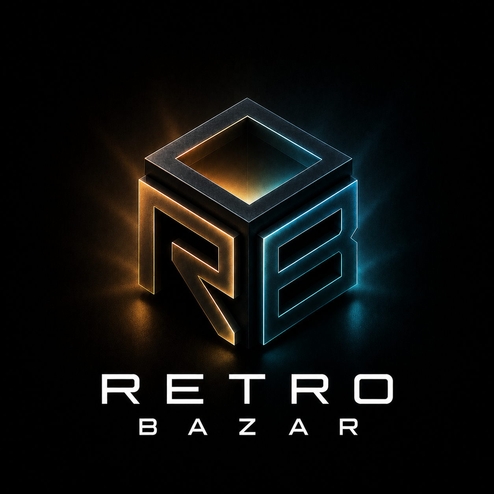
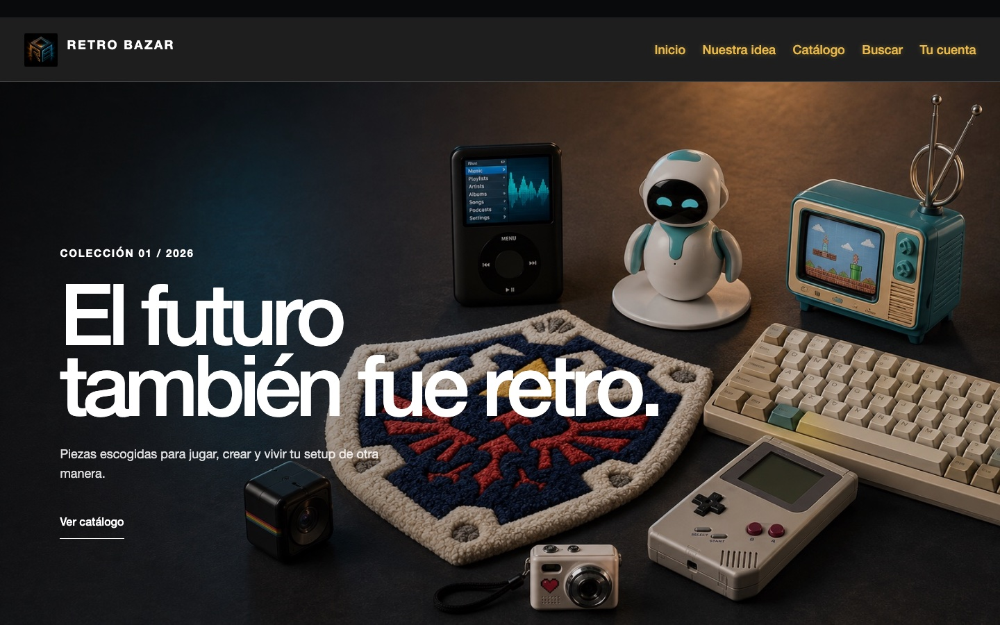
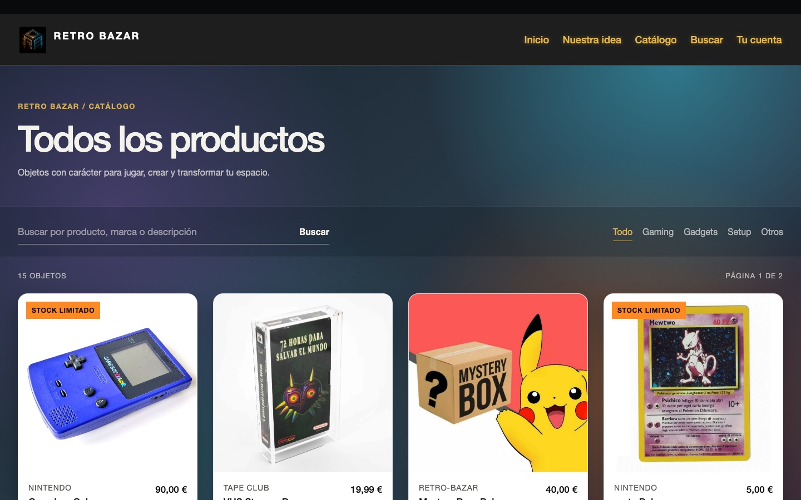
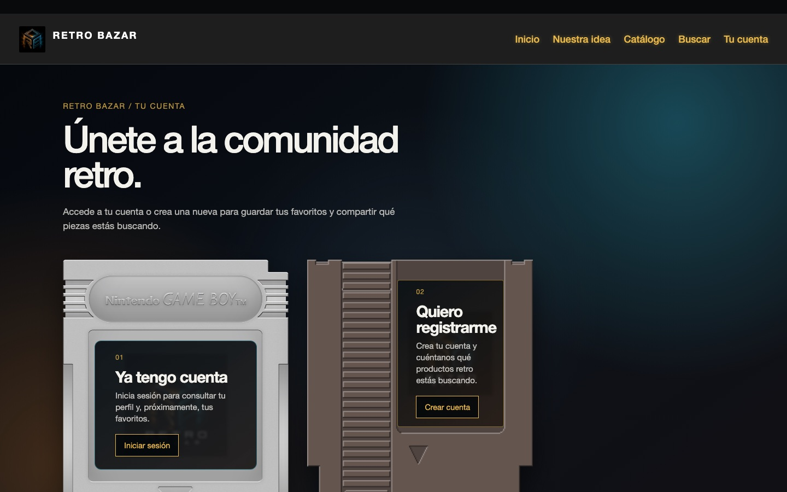
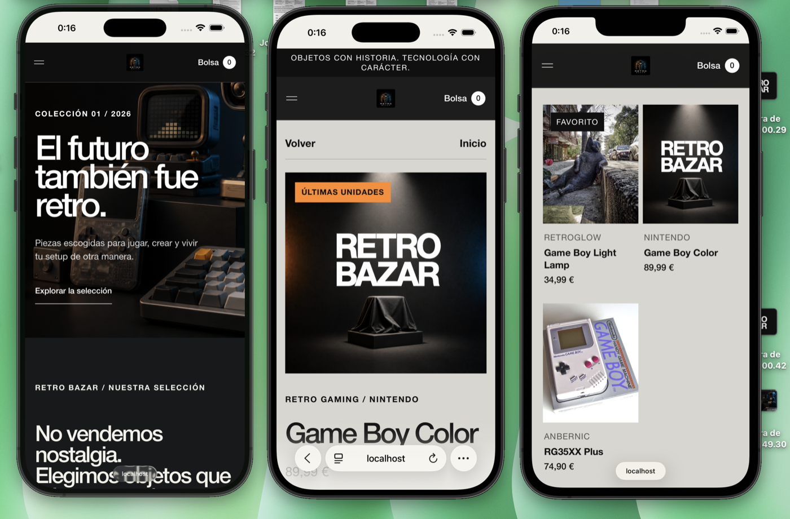
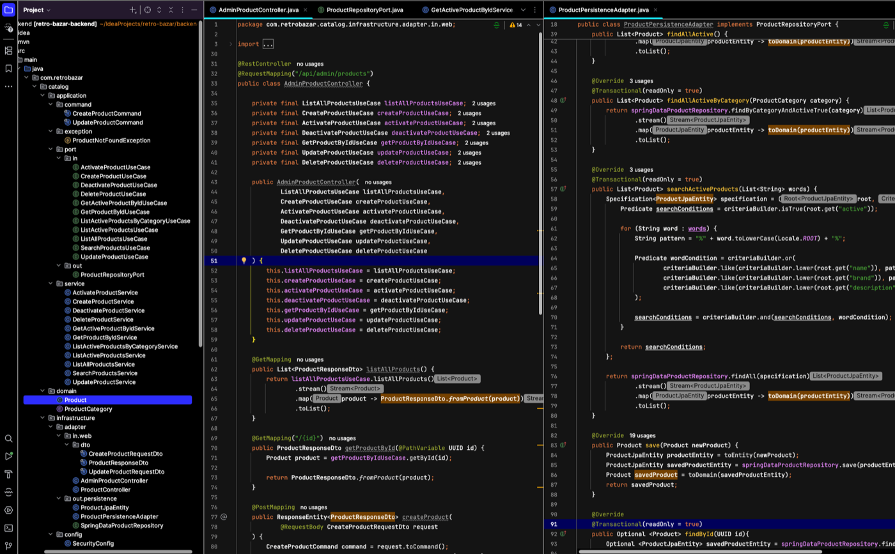
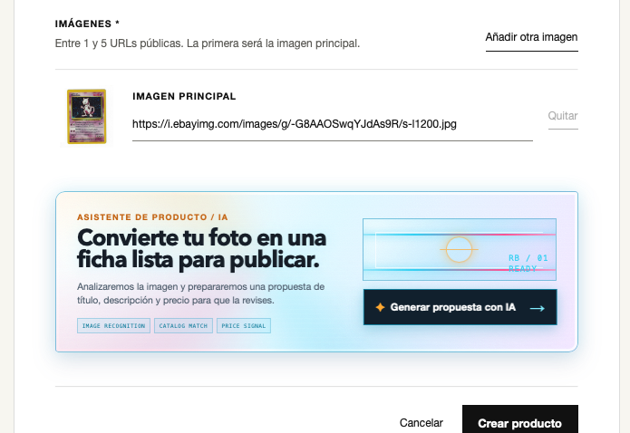
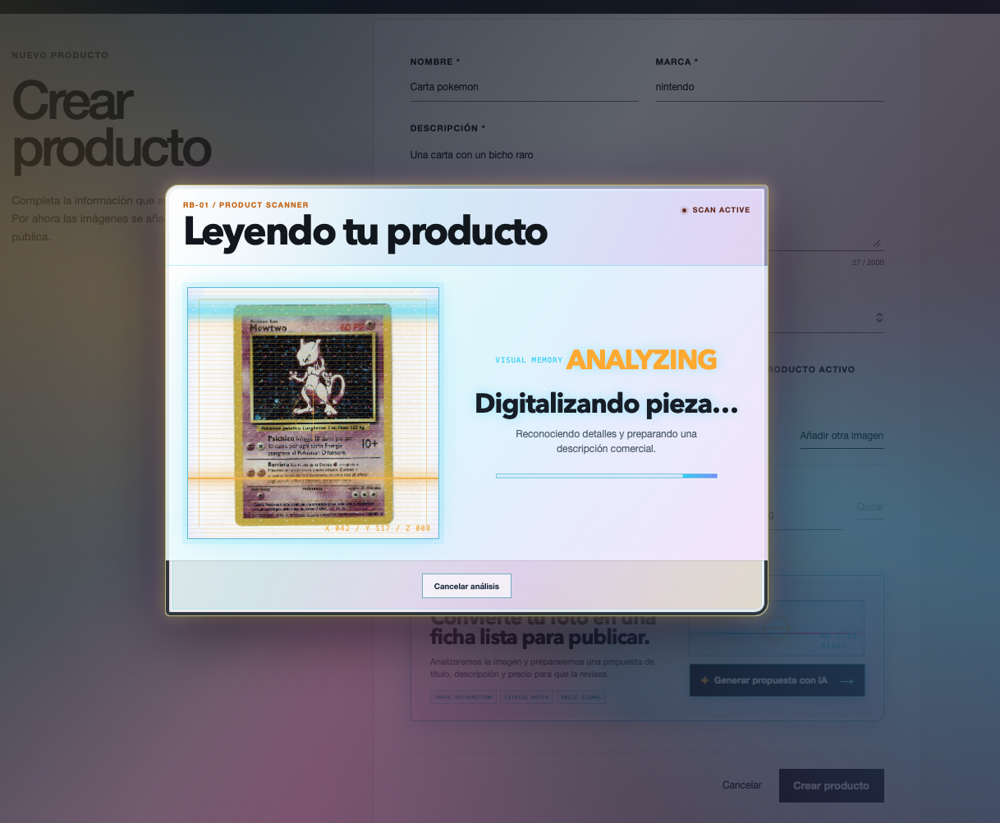
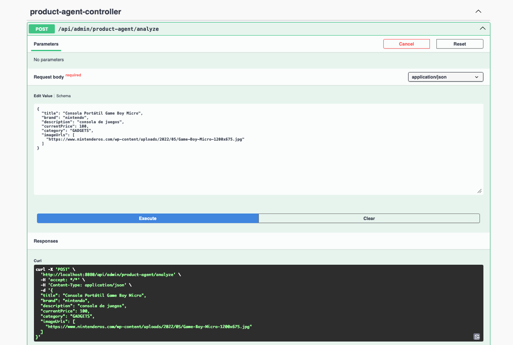
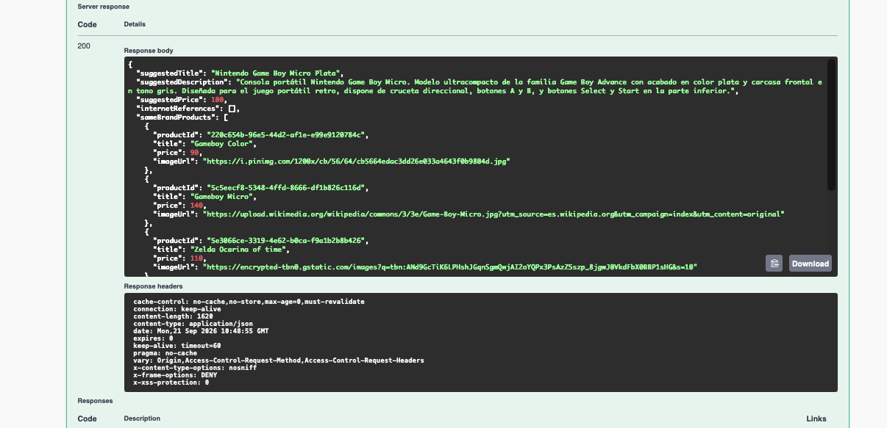

<div align="center">
  

  # Retro Bazar

  **Catálogo digital de productos retro, gaming, gadgets y accesorios para setups.**
</div>

## Estado del proyecto

Retro Bazar es un monolito modular en desarrollo y un proyecto de portfolio con
vocación de producto real. La aplicación permite descubrir y administrar piezas
retro desde una interfaz Angular conectada a una API REST desarrollada con
Spring Boot.

El repositorio contiene actualmente:

- Un catálogo público con listado, búsqueda, filtros por categoría y detalle.
- Registro, inicio de sesión, perfil de usuario y autorización por roles.
- Gestión administrativa de productos desde una zona protegida.
- Activación, desactivación y eliminación de productos.
- Asistente con IA para analizar imágenes y proponer una ficha editable.
- Validación de peticiones y respuestas de error estructuradas.
- Una interfaz responsive para escritorio y dispositivos móviles.
- Proxy de desarrollo para consumir la API desde Angular y compartir una
  demostración temporal mediante un túnel seguro.

Las siguientes fases se centrarán en las consultas asociadas a productos, los
enlaces de venta en Wallapop y las listas de deseos. El carrito y los pagos
internos no forman parte del alcance actual para evitar competir con el canal de
venta externo.

## Visión del producto y alcance del MVP

Retro Bazar se plantea como el escaparate propio de una selección de productos.
La aplicación reúne catálogo, administración, cuentas de usuario y, en las
siguientes fases, favoritos y consultas por producto. La compra se completará
en Wallapop cuando exista un anuncio disponible.

El flujo principal previsto es:

```text
Descubrir en Retro Bazar
        ↓
Consultar la ficha o guardar el producto
        ↓
Preguntar por su disponibilidad o abrir el anuncio
        ↓
Completar la compra en Wallapop
```

Retro Bazar no solicitará datos de pago ni gestionará envíos. La cuenta
permitirá mantener favoritos y reutilizar los datos de contacto al enviar una
consulta.

### Canales de contacto y venta previstos

- **Consulta sobre el producto:** cualquier visitante podrá preguntar por su
  estado, disponibilidad o publicación mediante un formulario asociado a la
  ficha.
- **Salida a Wallapop:** cuando exista un anuncio, la ficha enlazará al canal de
  venta mediante «Ver en Wallapop».
- **Favoritos:** los usuarios registrados podrán guardar productos y recuperar
  su selección en otras sesiones y dispositivos.

La integración con Wallapop utilizaría únicamente enlaces públicos mantenidos
por el administrador. Retro Bazar no solicitará credenciales de Wallapop ni
automatizará la plataforma mediante scraping o APIs privadas. El pago, el envío
y las disputas de esa opción se gestionarían fuera de Retro Bazar, de acuerdo
con las [condiciones de uso de Wallapop](https://about.wallapop.com/condiciones-de-uso/).

## Vista de la aplicación

### Portada

<p align="center">
  
</p>

### Catálogo

<p align="center">
  
</p>

### Tu cuenta

<p align="center">
  
</p>

### Experiencia responsive

<p align="center">
  
</p>

## Tecnologías

### Backend

- Java 21.
- Spring Boot 4.1.
- Spring Web MVC.
- Spring Data JPA y Hibernate.
- Spring Security.
- Bean Validation.
- MySQL.
- Springdoc OpenAPI y Swagger UI.
- Maven.
- JUnit, Mockito y Testcontainers.

### Frontend

- Angular 20.
- TypeScript.
- Angular Router.
- HttpClient, Signals y RxJS.
- HTML y CSS responsive.

## Arquitectura

El backend utiliza arquitectura hexagonal dentro de un monolito modular. Cada
módulo funcional se divide progresivamente en:

- **Dominio:** entidades y reglas del negocio independientes de Spring.
- **Aplicación:** casos de uso, comandos y puertos de entrada y salida.
- **Infraestructura:** controladores REST, persistencia, seguridad y
  configuración externa.

Los módulos implementados son `catalog`, `productagent` y `user`. `wishlist` es
la siguiente ampliación prevista. Los módulos `cart`, `order` y `event` se
conservan como documentación de posibles evoluciones, pero no forman parte del
alcance actual. `shared` contiene soporte técnico común y no representa un
módulo de negocio.

La infraestructura web común contiene el gestor global que transforma las
excepciones de aplicación y los errores HTTP en respuestas consistentes.

```text
retro-bazar/
├── backend/
│   └── src/
│       ├── main/java/com/retrobazar/
│       │   ├── catalog/        # Productos, categorías, precios y stock
│       │   ├── productagent/   # Valoración y mejora de fichas con IA
│       │   ├── user/           # Cuentas, autenticación, perfil y roles
│       │   ├── wishlist/       # Desarrollo futuro de favoritos
│       │   ├── cart/           # Posible ampliación, fuera del alcance actual
│       │   ├── order/          # Posible ampliación, fuera del alcance actual
│       │   ├── event/          # Posible gestión futura de ferias
│       │   └── shared/web/error/
│       └── test/
├── frontend/
│   └── src/app/
└── README.md
```

<p align="center">
  
</p>

<p align="center"><em>Puertos, casos de uso y adaptadores del módulo de catálogo.</em></p>

## Requisitos para desarrollo local

- JDK 21.
- Docker Desktop (recomendado para ejecutar MySQL 8.4) o una instalación local de MySQL 8.
- Node.js y npm.

Docker Compose se utiliza únicamente para la base de datos de desarrollo. El
backend y el frontend se siguen ejecutando directamente desde la terminal o el
IDE. No se han creado imágenes Docker para las aplicaciones.

## Configuración del backend

El backend reconoce estas variables de entorno:

| Variable | Valor local por defecto | Descripción |
|---|---|---|
| `DB_URL` | `jdbc:mysql://localhost:3307/retro_bazar?...` | Conexión con MySQL de Docker |
| `DB_USERNAME` | `root` | Usuario de la base de datos |
| `DB_PASSWORD` | `retro_bazar_local` | Contraseña local de la base de datos |
| `FRONTEND_ORIGIN` | `http://localhost:4200` | Origen permitido por CORS |
| `GEMINI_API_KEY` | Sin valor | Clave privada de Gemini utilizada por el agente de producto |
| `GEMINI_MODEL` | `gemini-3.6-flash` | Modelo de Gemini utilizado por Spring AI |

[`backend/.env.example`](backend/.env.example) documenta estas variables sin
incluir credenciales reales. Spring Boot no carga archivos `.env`
automáticamente: las variables deben configurarse en IntelliJ, en la terminal o
mediante la herramienta utilizada para ejecutar la aplicación.

Con Docker Desktop iniciado, levantar MySQL:

```bash
docker compose up -d
```

El contenedor crea la base de datos `retro_bazar`, escucha únicamente en
`localhost:3307` y conserva los datos en un volumen. Se utiliza el puerto 3307
para no interferir con una posible instalación local de MySQL en el 3306. Para
consultar su estado o detenerlo:

```bash
docker compose ps
docker compose down
```

`docker compose down` no elimina los datos. Solo se borran explícitamente con
`docker compose down --volumes`.

Si se utiliza una instalación local de MySQL en lugar de Docker, crear la base
de datos manualmente:

```sql
CREATE DATABASE retro_bazar;
```

Arrancar el backend:

```bash
cd backend
./mvnw spring-boot:run
```

La API se sirve en `http://localhost:8080`.

## Ejecución del frontend

Con el backend iniciado:

```bash
cd frontend
npm install
npm start
```

La aplicación se sirve en `http://localhost:4200`.

## API del catálogo

### Endpoints públicos

| Acción | Método | Endpoint |
|---|---|---|
| Listar productos activos | `GET` | `/api/products` |
| Filtrar por categoría | `GET` | `/api/products/category/{category}` |
| Buscar productos | `GET` | `/api/products/search?text={text}` |
| Consultar un producto activo | `GET` | `/api/products/{id}` |

### Autenticación y cuenta

| Acción | Método | Endpoint |
|---|---|---|
| Crear una cuenta | `POST` | `/api/auth/register` |
| Iniciar sesión | `POST` | `/api/auth/login` |
| Consultar el perfil autenticado | `GET` | `/api/users/me` |

### Endpoints administrativos

| Acción | Método | Endpoint |
|---|---|---|
| Listar todos los productos | `GET` | `/api/admin/products` |
| Consultar un producto | `GET` | `/api/admin/products/{id}` |
| Crear un producto | `POST` | `/api/admin/products` |
| Actualizar un producto | `PUT` | `/api/admin/products/{id}` |
| Eliminar un producto | `DELETE` | `/api/admin/products/{id}` |
| Activar un producto | `PATCH` | `/api/admin/products/{id}/activate` |
| Desactivar un producto | `PATCH` | `/api/admin/products/{id}/deactivate` |
| Analizar una ficha con IA | `POST` | `/api/admin/product-agent/analyze` |

La documentación interactiva está disponible con el backend iniciado en:

```text
http://localhost:8080/swagger-ui/index.html
```

Los endpoints administrativos requieren un token JWT con rol `ADMIN`. Angular
protege también las rutas del panel, aunque la autorización definitiva siempre
se aplica en el backend.

## Pruebas

Ejecutar las pruebas del backend:

```bash
cd backend
./mvnw test
```

Las pruebas unitarias no requieren Docker. La prueba de carga completa del
contexto utiliza Testcontainers y necesita un entorno Docker disponible. Para el
desarrollo habitual, la aplicación se ejecuta contra el MySQL levantado mediante
Docker Compose.

Comprobar el frontend:

```bash
cd frontend
npm run build
```

## Agente de IA para el alta de productos

El formulario administrativo ofrece la acción «Valorar con IA». A partir del
título, descripción, precio e imágenes introducidos, el agente propondrá una
ficha mejorada antes de crear el producto.

La implementación utiliza Spring AI y Gemini. En el MVP actual, el agente
analiza los datos y las imágenes y muestra los productos activos de la misma
marca que ya existen en el catálogo de Retro Bazar.

La búsqueda externa con Google Search Grounding queda desactivada porque no está
disponible mediante la API en el nivel gratuito de Gemini 3.6 Flash. Podrá
incorporarse posteriormente si el proyecto activa la facturación de Gemini. La
primera versión no pide al administrador que aporte enlaces externos.

### Flujo actual

1. El administrador completa el formulario y añade una o varias imágenes.
2. El backend consulta los productos activos de la misma marca.
3. Un diálogo compara los valores originales con la propuesta.
4. El administrador decide si aplica el nuevo título, descripción y precio.
5. El producto solo se guarda al confirmar el formulario habitual.

La valoración mostrará un precio orientativo y productos de la misma marca del
catálogo. Estos productos no se presentan como coincidencias ni como artículos
necesariamente similares. El agente no tendrá acceso directo a la base de datos
ni podrá crear, modificar o eliminar productos. Las referencias públicas de Internet se
añadirán únicamente si se habilita Google Search Grounding en una fase posterior.

La detección de productos realmente similares queda como mejora posterior al
MVP. Requerirá una estrategia de similitud semántica distinta de la consulta
determinista por marca utilizada en esta primera versión.

### Primer MVP del agente

<table>
  <tr>
    <td width="50%" align="center">
      
    </td>
    <td width="50%" align="center">
      
    </td>
  </tr>
  <tr>
    <td align="center"><strong>Acción disponible en el formulario</strong></td>
    <td align="center"><strong>Análisis de la imagen</strong></td>
  </tr>
  <tr>
    <td width="50%" align="center">
      
    </td>
    <td width="50%" align="center">
      
    </td>
  </tr>
  <tr>
    <td align="center"><strong>Petición desde Swagger</strong></td>
    <td align="center"><strong>Respuesta estructurada del agente</strong></td>
  </tr>
</table>

## Gestión futura de eventos

El módulo `event` es una posible ampliación y no está confirmado para la primera
versión. Permitirá preparar la asistencia de la tienda a ferias o mercadillos.

El propietario podrá crear un evento con imagen, ubicación y fechas; seleccionar
los productos y cantidades que llevará; registrar ventas presenciales; y
consultar las unidades vendidas, el stock restante y los ingresos obtenidos.

La política para reservar, descontar y devolver el stock general se decidirá al
diseñar este módulo.

## Hoja de ruta

1. **Estructura del frontend — completado.** La portada vive en un
   `HomeComponent` enrutado y `AppComponent` conserva únicamente el layout y la
   interacción global.
2. **Catálogo público — completado.** `/catalogo` ofrece búsqueda, filtros por
   categoría y paginación de diez productos en Angular. La portada mantiene una
   selección reducida y enlaza al catálogo completo.
3. **Administración protegida — completado.** El panel permite listar con
   filtros y paginación, crear, editar, activar, desactivar y eliminar productos.
   Las rutas y endpoints administrativos requieren el rol `ADMIN`.
4. **Catálogo administrable — completado.** Los productos, descripciones e
   imágenes se mantienen desde el panel mediante URLs públicas. `data.sql` se
   conserva como catálogo inicial de referencia, pero no se ejecuta
   automáticamente sobre la base de datos local.
5. **Agente de producto — completado.** Valora los datos e imágenes del formulario, muestra
   productos activos de la misma marca y ofrece una propuesta editable. La
   búsqueda externa queda como ampliación posterior sujeta a la disponibilidad
   y facturación de Google Search Grounding.
6. **Autenticación y autorización — completado.** Incluye registro, login, perfil,
   roles, JWT, guardas de Angular y protección de `/api/admin/**`.
7. **Estabilización y calidad.** Consolidar variables de entorno, actualizar la
   documentación, ampliar las pruebas del frontend y revisar accesibilidad.
8. **Consultas por producto.** Permitir preguntas sobre disponibilidad, estado o
   publicación; asociarlas al producto y gestionarlas desde administración.
9. **Canal de venta en Wallapop.** Añadir el enlace público del anuncio y estados
   como disponible, reservado o vendido. Retro Bazar no gestionará pagos.
10. **Listas de deseos.** Mantener una selección personal persistente y
    sincronizada entre sesiones y dispositivos.
11. **Eventos — por decidir.** Gestionar el stock y las ventas presenciales en
    ferias, si entra finalmente en el alcance de la primera versión.
12. **Preparación para publicación.** Configurar los entornos de Angular, añadir
    Dockerfiles para backend y frontend, ampliar Docker Compose y preparar el
    despliegue público.

## Alcance

El proyecto es una demostración técnica y un escaparate para una posible tienda
real. No procesará pagos ni envíos: las ventas se completarán mediante enlaces
públicos de Wallapop. El carrito y los pedidos internos quedan fuera del alcance
actual.
